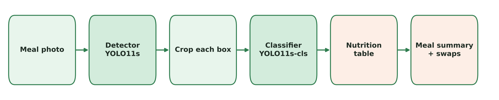
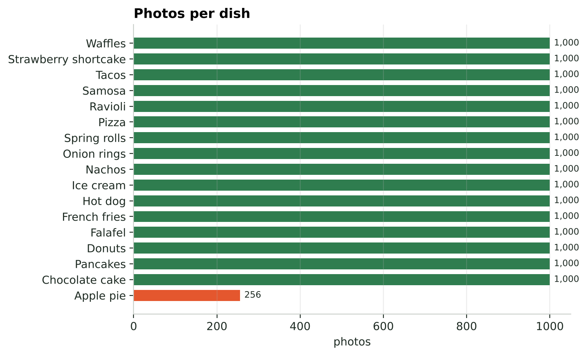
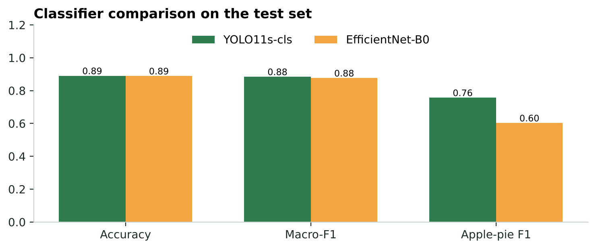
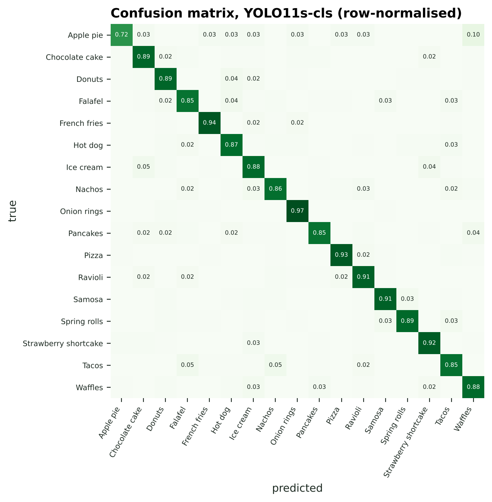
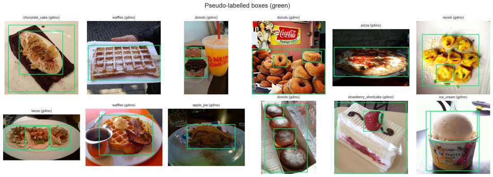
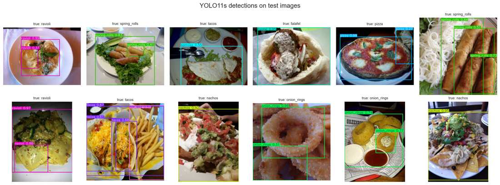
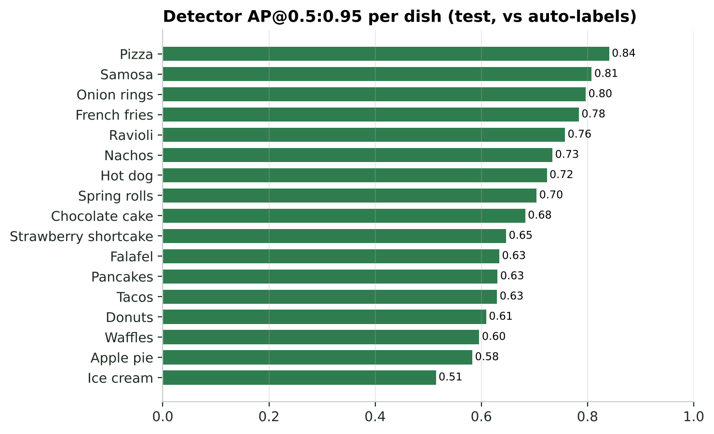

# NutriScan 🥗 — AI Food Detection & Classification

**Snap a meal → see every food item boxed and named → get calories, macros and a healthier swap.**

Capstone project · Deakin Master of Applied AI (Bridge) · Mohammad Alrashed

**Live app:** [Streamlit on Hugging Face](https://huggingface.co/spaces/DatariusAI/nutriscan) · [Gradio on Hugging Face](https://huggingface.co/spaces/DatariusAI/nutriscan-gradio) · **Models:** [DatariusAI/nutriscan-food-models](https://huggingface.co/DatariusAI/nutriscan-food-models) · **Notebook:** [`notebooks/NutriScan_Food_Detection.ipynb`](notebooks/NutriScan_Food_Detection.ipynb)

## Problem
Manual food logging is slow and error-prone. NutriScan needs to:
1. **Detect** food items in a user's photo (where is each item?).
2. **Classify** each item (what is it?).
3. Turn the result into nutrition data and personalised suggestions.

## Data
A 17-class subset of Food-101: apple pie, chocolate cake, donuts, falafel, French fries, hot dog, ice cream, nachos, onion rings,
pancakes, pizza, ravioli, samosa, spring rolls, strawberry shortcake, tacos, waffles. About 16,250 images.
16 classes have ~1,000 images. **Apple pie has 257**, so we oversample it and report macro-F1.
The data has **no bounding boxes**, only class folders.

## Approach
```
photo ──► YOLO11s detector ──► box crops ──► YOLO11s-cls classifier ──► label + confidence ──► nutrition table ──► meal summary
```
| Step | Method |
|---|---|
| Split | Stratified 70 / 15 / 15, seed 42 |
| Classifier A | YOLO11s-cls, ImageNet-pretrained, 224 px, AdamW + cosine LR, apple pie ×3 oversampling |
| Classifier B | EfficientNet-B0 (torchvision), weighted sampler, label smoothing, mixed precision |
| Box labels | Grounding DINO (open-vocabulary detector) prompted with "food." + class name → pseudo-boxes |
| Detector | YOLO11s, COCO-pretrained, 512 px, trained on the pseudo-boxes |
| Pipeline | Detector proposes boxes, classifier re-labels each crop, keep the more confident label |

## Results (held-out test split)
**Classification**

| Model | Accuracy | Macro-F1 | Apple-pie F1 | ms / image (T4) | Params (M) |
|---|---|---|---|---|---|
| YOLO11s-cls | 89.0% | 0.884 | 0.757 | 6.4 | 5.5 |
| EfficientNet-B0 | 88.9% | 0.876 | 0.603 | 5.1 | 4.0 |

**Detection (YOLO11s, scored against pseudo-label boxes)**

| mAP@0.5 | mAP@0.5:0.95 |
|---|---|
| 0.786 | 0.687 |

**Naming the dish end to end (true folder labels)**

| Approach | Accuracy |
|---|---|
| A. detector only | 87.9% |
| B. classifier, whole image | 89.3% |
| C. detect → classify | 88.6% |

Whole-image classification scores slightly higher on single-dish photos. The app still ships detect → classify,
because only the boxed version can handle plates with several items and size portions from the box.









## Limitations
- Detector mAP is measured against machine-generated boxes, not hand-drawn ground truth.
- 17 classes only; real meals contain far more foods. An "unknown" threshold is needed before launch.
- Nutrition values are per typical serving (approximate); portion size from one 2-D photo is rough.
- The user-pattern analysis in the notebook uses a simulated food log.

## Repository layout
```
app/app.py                 Streamlit app (also runs on Streamlit Cloud; weights pulled from the HF model repo)
gradio_app/app.py          Gradio version of the app (Hugging Face Space)
app/nutrition.json         per-serving nutrition + healthier swaps for the 17 dishes
notebooks/                 end-to-end notebook with outputs (EDA → training → evaluation → app)
deploy/Dockerfile          Hugging Face Space image (CPU)
deploy/deploy.py           publishes models + Space from Colab
deploy/build_nb.py         generates the notebook from source
```

## Run locally
```bash
pip install -r requirements.txt
streamlit run app/app.py
```

## References
- Bossard, Guillaumin & Van Gool (2014). Food-101 — Mining Discriminative Components with Random Forests. ECCV.
- Tan & Le (2019). EfficientNet: Rethinking Model Scaling for Convolutional Neural Networks. ICML.
- Liu et al. (2023). Grounding DINO: Marrying DINO with Grounded Pre-Training for Open-Set Object Detection. arXiv:2303.05499.
- Jocher, Qiu & Chaurasia (2024). Ultralytics YOLO11. https://github.com/ultralytics/ultralytics

Nutrition values are approximate and for guidance only, not medical advice.
